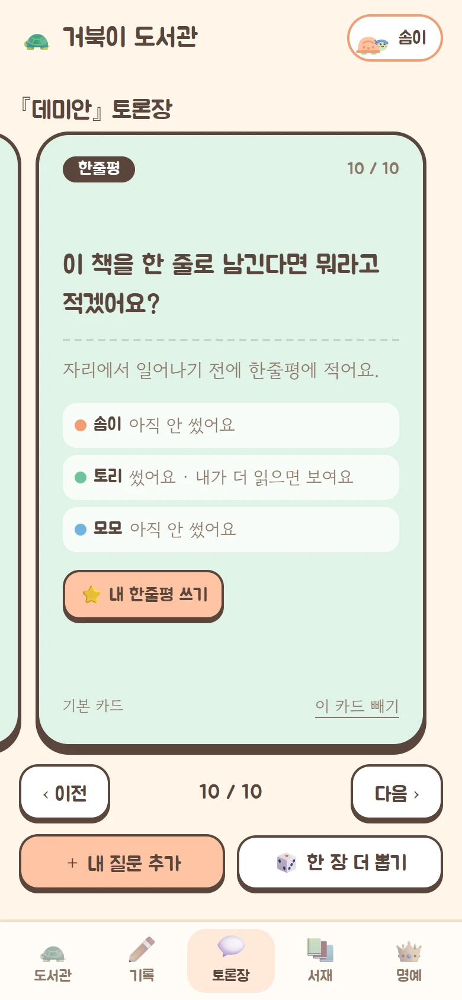

<div align="center">


# 거북이 도서관

**느릿느릿, 한 달에 한 권.**<br>
친구들과 같이 읽고, 만나서 이야기하는 작은 독서토론 웹앱

[**📖 사용 가이드**](https://turtle-library.vocaday.workers.dev/guide) · [🐢 앱 열기](https://turtle-library.vocaday.workers.dev)

&nbsp;
&nbsp;


</div>

## 어떤 앱인가요

친구 셋이 한 달에 한 권을 읽고 만나서 토론하려고 만들었습니다. 혼자 쓰는 독서 기록 앱이 아니라, **책 고르기 → 날 잡기 → 읽기 → 만나서 토론 → 다음 책**으로 이어지는 모임 한 바퀴를 통째로 챙겨 줍니다.

- 돌아가며 책을 고르고, 각자 되는 날을 골라 **모두 되는 날 중 하루를 뽑아** 토론일을 정합니다.
- 읽은 만큼 **캐릭터가 진화**하고(아기 거북이 → 토끼), 가장 먼저 다 읽은 친구는 **왕관**을 씁니다.
- 읽으면서 **한줄평 · 메모 · 구절**을 남기고, 친구가 나보다 뒤쪽에서 쓴 기록은 **스포일러로 가려집니다**.
- 토론 날에는 **큐카드**를 넘기며 이야기합니다. "이 부분 좋았지"에서 끝나지 않도록 입장이 갈리는 질문을 순서대로 준비해 둡니다.
- 토론 다음 날 자동으로 다음 친구 차례로 넘어가고, 기록은 **명예의 전당**에 쌓입니다.

설치 없이 폰 브라우저에서 열고 "홈 화면에 추가"하면 앱처럼 씁니다. 처음 쓰는 친구에게는 [사용 가이드](https://turtle-library.vocaday.workers.dev/guide)를 보내 주세요.

## 한 달의 흐름

<table>
<tr>
<td width="260"></td>
<td>

### 1. 이번 차례인 친구가 책을 골라요

책 고르는 순번은 돌아갑니다. 내 차례가 되면 도서관 화면에 책 등록 칸이 나타납니다.

- 제목, 지은이, 전체 쪽수를 적습니다.
- 소설 · 비문학 · 에세이 중 하나를 고르면 토론 카드가 그 종류에 맞춰 준비됩니다.

</td>
</tr>
<tr>
<td></td>
<td>

### 2. 각자 되는 날을 골라 토론일을 정해요

- 달력에서 모일 수 있는 날을 전부 누르고 확정합니다.
- 친구가 고른 날에는 그 친구 색의 점이, 모두 되는 날에는 금색 별이 표시됩니다.
- 전원이 확정하면 겹치는 날 가운데 하루가 무작위로 뽑힙니다.
- 일정이 틀어지면 "날짜 다시 정하기"로 다시 고릅니다.

</td>
</tr>
<tr>
<td></td>
<td>

### 3. 토론일까지 읽고, 읽은 만큼 기록해요

- 도서관 맨 위에 각자 읽은 쪽수가 보이고, 캐릭터들이 도서관을 돌아다닙니다.
- 슬라이더를 밀거나 쪽수를 적어 기록합니다.
- 30 · 50 · 70 · 100%에서 캐릭터가 진화합니다.

</td>
</tr>
<tr>
<td></td>
<td>

### 4. 만나서 카드를 넘기며 이야기해요

- 토론 당일에는 가려져 있던 친구들의 기록이 모두 열립니다.
- 카드는 손으로 밀거나 이전 · 다음 버튼으로 넘깁니다.
- 각자 미리 넣어 둔 질문도 같은 덱에 섞여 나옵니다.

</td>
</tr>
<tr>
<td></td>
<td>

### 5. 다음 날, 다음 책으로 넘어가요

- 캐릭터는 모두 아기 거북이로 돌아가고, 다음 순번 친구에게 책 고를 차례가 넘어갑니다.
- 이번 책의 왕관 주인은 **명예의 전당**에 기록됩니다.
  - **빨리 읽기 왕** — 모임 책을 가장 먼저 다 읽은 횟수
  - **다독왕** — 모임 책과 서재의 책을 합쳐 끝까지 읽은 권수
  - **함께 읽은 책** — 지난 책을 누르면 그날의 토론 카드와 기록을 다시 볼 수 있습니다

</td>
</tr>
</table>

## 읽을수록 진화하는 캐릭터


처음엔 느릿느릿 아기 거북이, 다 읽으면 깡충깡충 토끼. 단계가 오를수록 도서관을 더 빨리 돌아다닙니다. 그 책을 **가장 먼저 끝까지 읽은 한 명**에게 왕관이 올라가고, 책이 바뀌면 왕관도 다시 비워집니다. 캐릭터는 이미지 파일 없이 전부 인라인 SVG로 그렸고, 몸 색은 각자 고른 색을 따릅니다.


## 기능 둘러보기

<table>
<tr>
<td width="260"></td>
<td>

### 기록

- **메모** — 읽다가 든 생각. 길게 써도 됩니다.
- **구절** — 밑줄 긋고 싶은 문장과 쪽수.
- **한줄평** — 별점과 한 문장. 책마다 하나.
- **스포일러 가림** — 친구가 내가 읽은 쪽보다 뒤에서 쓴 기록은 흐리게 가려지고, 눌러야 보입니다. 토론 당일과 지난 책은 모두 보입니다.

</td>
</tr>
<tr>
<td></td>
<td>

### 토론장

- 한 회 9~10장: **첫인상 → 밑줄 낭독 → 해석 → 입장 → 내 이야기 → 마무리**.
- `[공감한다 / 공감하기 어렵다]`처럼 **먼저 입장을 고르게 하는 선택지**가 칩으로 보입니다.
- 카드 아래 "더 물어보기"가 근거가 되는 대목으로 되돌려 줍니다.
- 내 질문 추가, 한 장 더 뽑기, 책에 안 맞는 카드 빼기.
- 마지막 카드에서 그 자리에서 한줄평을 남깁니다.

</td>
</tr>
<tr>
<td></td>
<td>

### 나의 서재

- 모임 책 말고 따로 읽는 책도 등록해 진행도와 기록을 남깁니다.
- 다 읽은 책은 **금색 표지에 완독 도장**.
- 모임에서 읽은 책은 자동으로 꽂히고, 친구의 서재도 구경할 수 있습니다.

</td>
</tr>
<tr>
<td></td>
<td>

### 한 줄 남기기

- 덱의 마지막 두 장은 **별점 다시 매기기**와 **한 줄 남기기**입니다.
- 처음 준 별점이 이야기를 나눈 뒤 어떻게 달라졌는지가 그날 토론의 기록이 됩니다.
- 마지막 카드에 친구들의 별점과 한줄평이 모이고, 그 자리에서 바로 적을 수 있습니다.

</td>
</tr>
</table>

## 토론 카드는 이렇게 만들었어요

책마다 내용을 알 수는 없으니, 독서모임들이 실제로 어떻게 토론하는지 조사해 범용 카드 67장을 직접 썼습니다. 전체 내용은 [조사 보고서](reports/독서토론%20질문과%20진행%20방식.md)에 있습니다.

- **카드가 장면을 정하지 않습니다.** "주제가 뭔가요" 대신 "가장 이해하기 어려웠던 인물의 선택 하나를 함께 골라요"처럼, 읽은 사람이 대목을 지목하게 합니다.
- **입장을 먼저 고르게 합니다.** 한국 독서모임의 찬반 논제 방식대로 "공감한다 / 공감하기 어렵다"를 동시에 말하고, 혼자 다른 답을 한 사람부터 이유를 댑니다.
- **텍스트에 붙은 질문이 먼저, 내 이야기는 나중**입니다.
- 범용 카드는 바닥일 뿐이라, 그달 책을 고른 사람이 넣는 질문 한두 장이 섞일 때 덱이 완성됩니다.

## 기술 구성

- **Cloudflare Workers + D1** 하나로 화면 · API · DB를 모두 올립니다. 무료 플랜으로 충분합니다.
- **빌드 단계 없음.** 프레임워크 없이 HTML · CSS · JS 모듈만 쓰고, 의존성은 `wrangler` 하나입니다.
- 서버는 요청마다 모임 전체 상태를 내려주고, 화면은 받은 상태를 그대로 다시 그립니다.
- 모임 규칙(진화 단계, 토론일 추첨, 왕관, 순번)은 `public/rules.js`의 순수 함수로 모아 서버와 화면이 같이 씁니다.
- 로그인: PBKDF2 해시, HttpOnly 세션 쿠키, 10회 실패 시 10분 잠금, 다른 사이트에서 온 요청 차단, CSP.

```
public/        화면 (index.html, style.css, app.js, critters.js) + rules.js(서버와 같이 쓰는 규칙)
public/guide*  사용 가이드 페이지(정적 HTML)와 화면 캡처
src/worker.js  API: 로그인, 사이클 넘기기, 모든 변경 요청
src/auth.js    비밀번호 해시와 세션 토큰
src/deck.js    토론 덱 구성        src/cards.js  카드 문항
schema.sql     DB 스키마
scripts/users.mjs  계정 만들기 / 비밀번호 재발급
test/          규칙과 덱 테스트 (node --test)
```

## 내 모임에 띄우기

Cloudflare 계정과 Node.js가 필요합니다.

```sh
git clone https://github.com/dpfla8628/turtle-library.git && cd turtle-library
npm install
npx wrangler login

# 1. DB 만들기 → 출력된 database_id 를 wrangler.jsonc 에 넣는다
npx wrangler d1 create book-club
npm run db:remote

# 2. 계정 만들기 (가입 화면이 없다). 비밀번호가 화면에 한 번 나온다
node scripts/users.mjs yerim:예림 minji:민지 sua:수아
npx wrangler d1 execute book-club --remote --file=users.local.sql

# 3. 배포
npm run deploy
```

| 할 일 | 명령 |
|---|---|
| 친구 추가 (순번은 맨 뒤) | `node scripts/users.mjs 아이디:이름` 후 `--remote --file=users.local.sql` 실행 |
| 비밀번호 재발급 | `node scripts/users.mjs --reset 아이디` 후 같은 방법으로 실행 |
| 내 PC에서 돌리기 | `npm run db:local` → `--local --file=users.local.sql` → `npm run dev` |
| 테스트 | `npm test` |

이름 · 색 · 비밀번호는 각자 앱의 "내 정보"에서 바꿉니다.

## 규칙 바꾸기

| 규칙 | 지금 값 | 있는 곳 |
|---|---|---|
| 진화 기준 | 0 · 30 · 50 · 70 · 100% | `public/rules.js` `STAGES` |
| 가장 빨리 읽은 사람 | 그 책에서 100%를 가장 먼저 기록한 사람 | `crownOf` |
| 다독왕 | 모임 책 + 서재의 개인 책 완독 권수 | `fame` |
| 토론일 | 전원이 고른 미래 날짜 중 무작위 하루 (오늘 제외, 90일 안) | `unanimous`, `src/worker.js` `dates` |
| 사이클 넘기기 | 토론 다음 날(한국 시간) 누군가 접속할 때 | `src/worker.js` `rollover` |
| 스포일러 가림 | 내가 읽은 쪽보다 뒤에서 쓴 친구의 기록 | `public/app.js` `veiled` |
| 토론 덱 | 워밍업 2 → 밑줄 → 해석 1 → 입장 2 → 연결 1 → 마무리 2~3 | `src/deck.js`, 문항은 `src/cards.js` |

## 일부러 안 만든 것

- **책별 맞춤 질문 자동 생성(AI)** — API 키와 비용이 필요해서 뺐습니다. 범용 카드에 직접 추가하는 질문을 섞습니다.
- **실시간 동기화** — 30초마다, 그리고 앱으로 돌아올 때 새로 받아 옵니다.
- **알림(푸시)** — 없습니다. 토론일은 각자 달력에 적어 둡니다.
- **나만 보는 메모** — 모든 기록은 모임 친구에게 보입니다(스포일러 가림만 있음).

코드 안에서 일부러 단순하게 둔 곳(비밀번호 해시 반복 수, 전체 상태를 한 번에 내려주기, 카드 넘김 애니메이션)은 `ponytail:` 주석에 한계와 바꿀 시점을 적어 두었습니다.
