<div align="center">


# 거북이 도서관

**느릿느릿, 한 달에 한 권.**<br>
친구들과 같이 읽고, 만나서 이야기하는 작은 독서토론 웹앱

[**📖 사용 가이드**](https://turtle-library.vocaday.workers.dev/guide) · [🐢 앱 열기](https://turtle-library.vocaday.workers.dev)

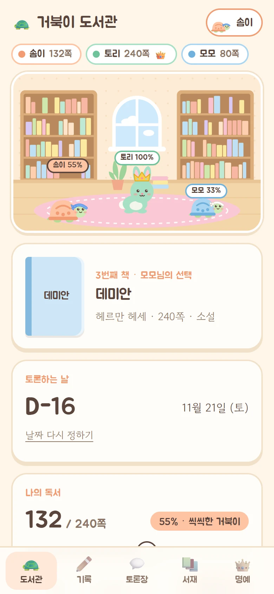&nbsp;
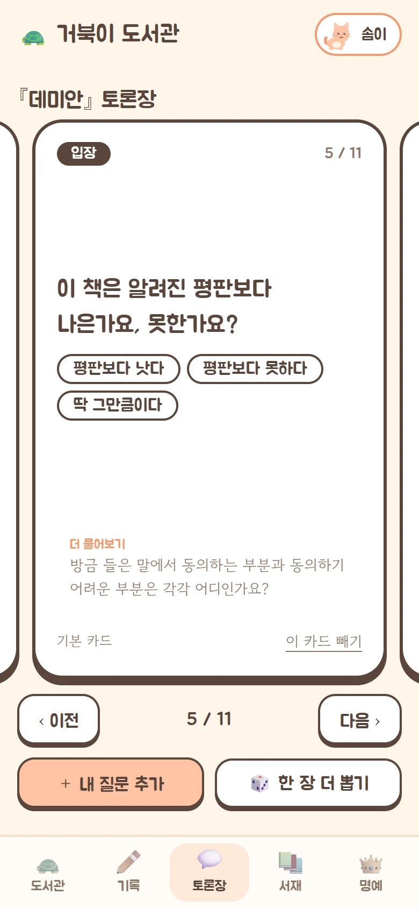&nbsp;
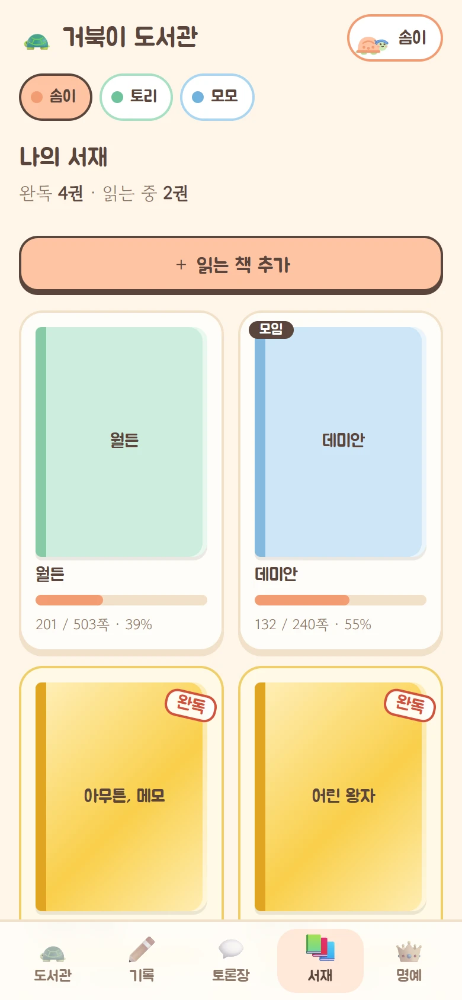

</div>

## 어떤 앱인가요

친구 셋이 한 달에 한 권을 읽고 만나서 토론하려고 만들었습니다. 혼자 쓰는 독서 기록 앱이 아니라, **책 고르기 → 날 잡기 → 읽기 → 만나서 토론 → 다음 책**으로 이어지는 모임 한 바퀴를 통째로 챙겨 줍니다.

- 돌아가며 책을 고르고, 각자 되는 날을 골라 **모두 되는 날 중 하루를 뽑아** 토론일을 정합니다.
- 읽은 만큼 **캐릭터가 진화**하고(미니미 거북이 → 달리는 거북이 → 토끼), 가장 먼저 다 읽은 친구는 **왕관**을 씁니다.
- 읽으면서 **한줄평 · 메모 · 구절**을 남기고, 친구가 나보다 뒤쪽에서 쓴 기록은 **스포일러로 가려집니다**.
- 토론 날에는 **큐카드**를 넘기며 이야기합니다. 첫 카드가 줄거리를 짧게 되짚어 주고, 그 책의 인물과 주장을 짚는 질문("내가 안진진이라면 누구와 결혼했을까요?")이 이어집니다.
- 토론 다음 날 자동으로 다음 친구 차례로 넘어가고, 기록은 **명예의 전당**에 쌓입니다.
- 친구가 읽었을 때, 토론일이 정해졌을 때, 토론 전날에 **알림**이 옵니다.

설치 없이 폰 브라우저에서 열고 "홈 화면에 추가"하면 앱처럼 씁니다. 처음 쓰는 친구에게는 [사용 가이드](https://turtle-library.vocaday.workers.dev/guide)를 보내 주세요.

## 한 달의 흐름

<table>
<tr>
<td width="260">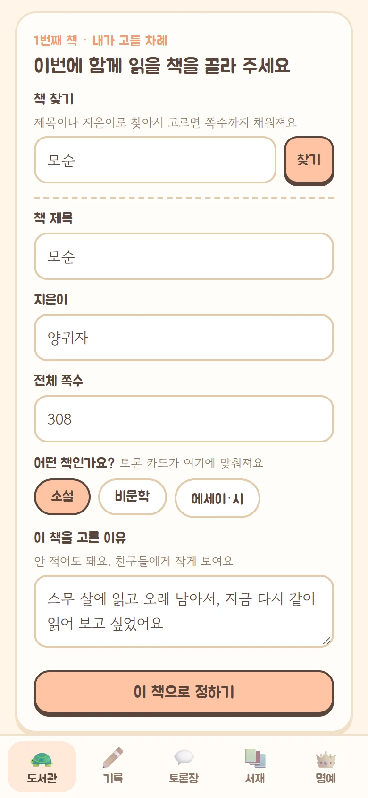</td>
<td>

### 1. 이번 차례인 친구가 책을 골라요

책 고르는 순번은 돌아갑니다. 내 차례가 되면 도서관 화면에 책 등록 칸이 나타납니다.

- 제목, 지은이, 전체 쪽수를 적습니다. [책 찾기](#책-찾기-선택-기능)를 켜 두었다면 제목으로 찾아서 고르기만 해도 지은이와 쪽수가 채워집니다.
- 소설 · 비문학 · 에세이 중 하나를 고르면 토론 카드가 그 종류에 맞춰 준비됩니다.
- **이 책을 고른 이유**를 한 줄 적을 수 있습니다(안 적어도 됩니다). 친구들의 책 카드와 토론 첫 카드에 작게 보입니다.

</td>
</tr>
<tr>
<td>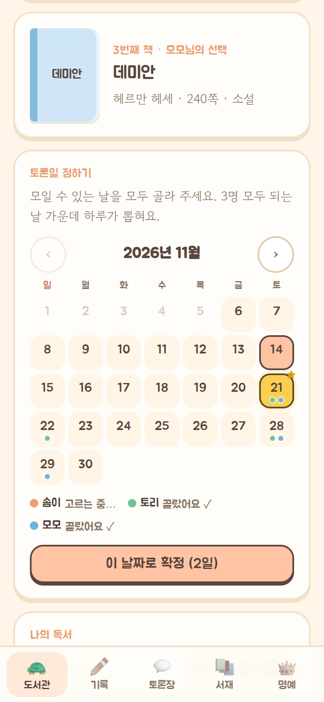</td>
<td>

### 2. 각자 되는 날을 골라 토론일을 정해요

- 달력에서 모일 수 있는 날을 전부 누르고 확정합니다.
- 친구가 고른 날에는 그 친구 색의 점이, 모두 되는 날에는 금색 별이 표시됩니다.
- 전원이 확정하면 겹치는 날 가운데 하루가 무작위로 뽑힙니다.
- 일정이 틀어지면 "날짜 다시 정하기"로 다시 고릅니다.

</td>
</tr>
<tr>
<td>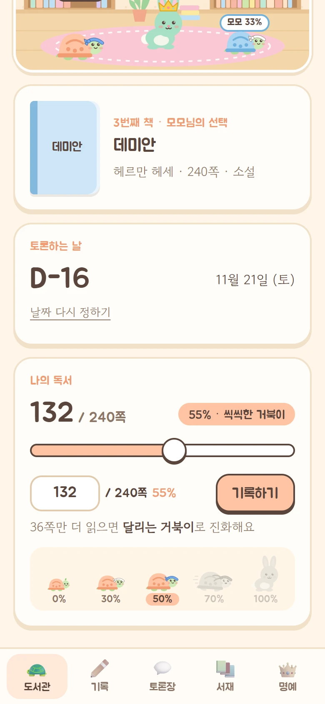</td>
<td>

### 3. 토론일까지 읽고, 읽은 만큼 기록해요

- 도서관 맨 위에 각자 읽은 쪽수가 보이고, 캐릭터들이 도서관을 돌아다닙니다.
- 슬라이더를 밀거나 쪽수를 적어 기록합니다.
- 30 · 50 · 70 · 100%에서 캐릭터가 진화합니다.

</td>
</tr>
<tr>
<td>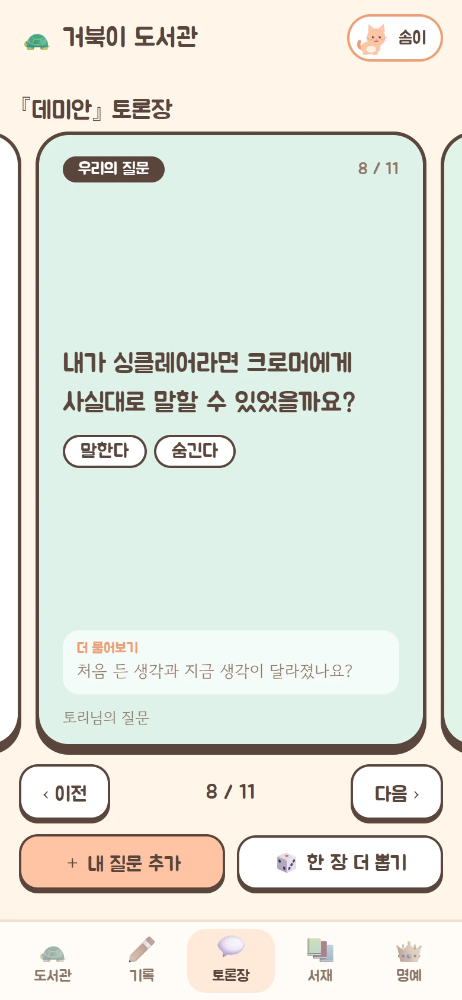</td>
<td>

### 4. 만나서 카드를 넘기며 이야기해요

- 토론 당일에는 가려져 있던 친구들의 기록이 모두 열립니다.
- 카드는 손으로 밀거나 이전 · 다음 버튼으로 넘깁니다.
- 각자 미리 넣어 둔 질문도 같은 덱에 섞여 나옵니다.

</td>
</tr>
<tr>
<td>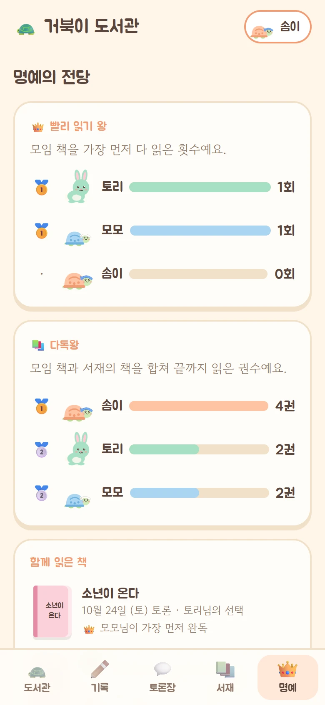</td>
<td>

### 5. 다음 날, 다음 책으로 넘어가요

- 캐릭터는 모두 미니미 거북이로 돌아가고, 다음 순번 친구에게 책 고를 차례가 넘어갑니다.
- 토론을 못 했는데 날짜가 지나 넘어가 버렸다면, 새 책이 정해지기 전까지 **되돌리기**로 지난 책을 다시 열어 날짜를 새로 잡을 수 있습니다.
- 이번 책의 왕관 주인은 **명예의 전당**에 기록됩니다.
  - **빨리 읽기 왕** — 모임 책을 가장 먼저 다 읽은 횟수
  - **다독왕** — 모임 책과 서재의 책을 합쳐 끝까지 읽은 권수
  - **함께 읽은 책** — 지난 책을 누르면 그날의 토론 카드와 기록을 다시 볼 수 있습니다

</td>
</tr>
</table>

## 읽을수록 진화하는 캐릭터

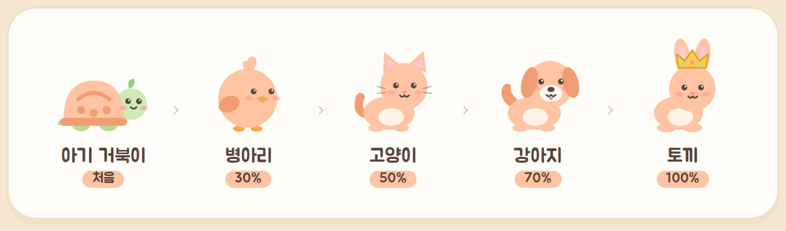

처음엔 느릿느릿 미니미 거북이. **70%까지는 계속 거북이**로, 읽을수록 몸이 자라고 머리띠가 흰색(30%) → 파랑(50%) → 빨강(70%)으로 바뀌며 마지막엔 머리띠를 휘날리며 달립니다. **토끼는 끝까지 다 읽어야만** 될 수 있습니다. 단계가 오를수록 도서관을 더 빨리 돌아다닙니다. 그 책을 **가장 먼저 끝까지 읽은 한 명**에게 왕관이 올라가고, 책이 바뀌면 왕관도 다시 비워집니다. 캐릭터는 이미지 파일 없이 전부 인라인 SVG로 그렸고, 몸 색은 각자 고른 색을 따릅니다.

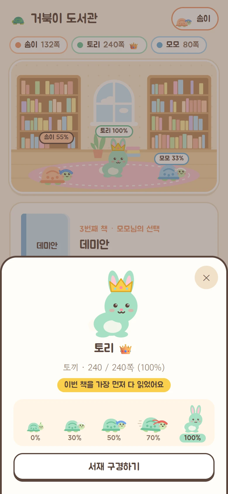

## 기능 둘러보기

<table>
<tr>
<td width="260">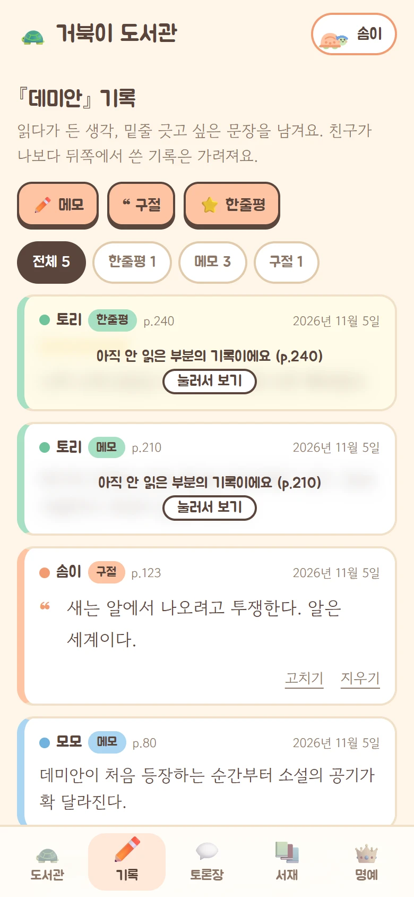</td>
<td>

### 기록

- **메모** — 읽다가 든 생각. 길게 써도 됩니다.
- **구절** — 밑줄 긋고 싶은 문장과 쪽수.
- **한줄평** — 별점과 한 문장. 책마다 하나.
- **스포일러 가림** — 친구가 내가 읽은 쪽보다 뒤에서 쓴 기록은 흐리게 가려지고, 눌러야 보입니다. 토론 당일과 지난 책은 모두 보입니다.

</td>
</tr>
<tr>
<td></td>
<td>

### 토론장

- **첫 카드는 "이 책은"**: 줄거리를 두세 문장으로 되짚고, 책을 고른 친구가 적어 둔 이유를 함께 보여 줍니다. "이런 이야기였죠. 자, 그럼 시작해 볼까요?" 하고 여는 카드입니다.
- 이어서 **이 책의 질문** 다섯 장쯤, 그리고 어느 책에나 쓰는 기본 카드 여덟 장(소설이면 인물 → 선택 → 나라면 → 물음 → 내 이야기).
- 전부 **책의 내용을 두고 생각이 갈리는 질문**입니다. 별점, 평판, 추천 여부처럼 한마디로 끝나는 질문과 낭독 · 한줄평 같은 진행용 카드는 없습니다.
- `[옳았다 / 옳지 않았다]`처럼 **먼저 입장을 고르게 하는 선택지**가 칩으로 보입니다.
- 소설은 **주인공 이름**을 적어 두면 기본 카드가 "내가 안진진이라면…"처럼 그 이름으로 묻습니다.
- 내 질문 추가, 한 장 더 뽑기, 책에 안 맞는 카드 빼기.

</td>
</tr>
<tr>
<td></td>
<td>

### 나의 서재

- 모임 책 말고 따로 읽는 책도 등록해 진행도와 기록을 남깁니다.
- 다 읽은 책은 **금색 표지에 완독 도장**.
- 모임에서 읽은 책은 자동으로 꽂히고, 친구의 서재도 구경할 수 있습니다.

</td>
</tr>
<tr>
<td>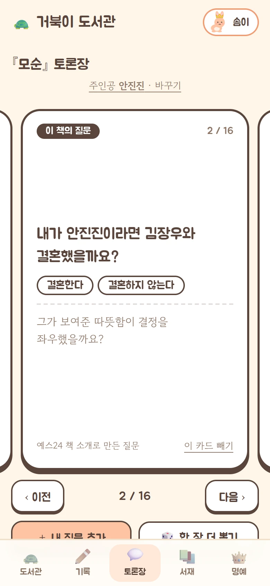</td>
<td>

### 이 책에 맞춘 카드

- 책을 정하면 10초쯤 뒤에 **줄거리 카드와 그 책만의 질문**이 덱 맨 앞에 도착합니다.
- 예스24의 책 소개글을 무료 AI에게 읽혀 만듭니다. 소개에 나온 인물과 주장만 쓰게 해서 **결말은 나오지 않습니다**.
- 어색한 카드는 빼면 되고, 모두 빼면 "이 책에 맞는 질문 받기"로 다시 받을 수 있습니다.
- [책 찾기](#책-찾기-선택-기능)를 켠 모임에서만 동작합니다. 소개글이 없는 책은 기본 카드만 준비됩니다.

</td>
</tr>
<tr>
<td>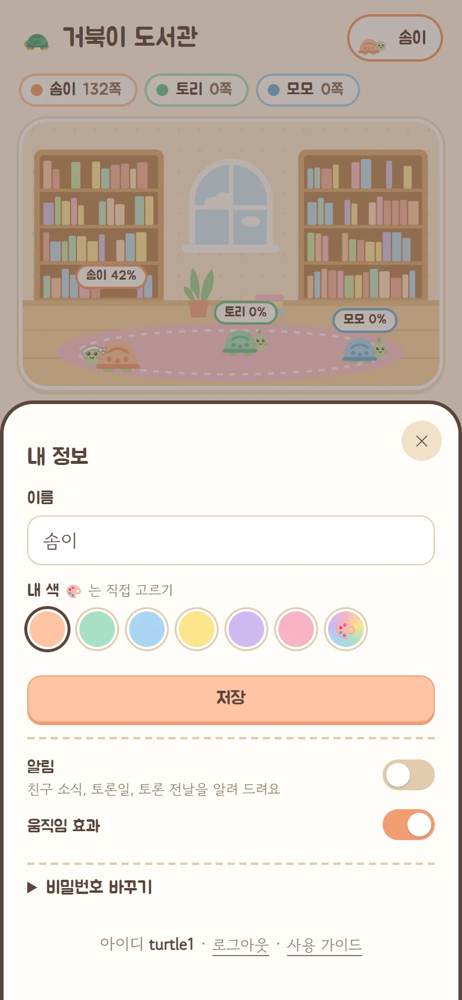</td>
<td>

### 알림

"내 정보"에서 **이 기기에서 알림 켜기**를 누르면 됩니다. 기기마다 따로 켭니다.

- **친구 독서 소식** — 친구가 10% 구간을 넘겨 읽었을 때, 진화했을 때, 다 읽었을 때, 토론 질문을 추가했을 때. 이 묶음만 따로 끌 수 있습니다.
- **일정** — 책이나 토론일이 정해졌을 때, 토론 전날 아침("내일이 토론일이에요!")과 당일 아침, 내가 책을 고를 차례가 됐을 때
- 책이나 날짜 선택을 잊은 친구에게는 월 · 목 아침에 한 번 더 알립니다.
- 아이폰은 홈 화면에 추가한 뒤에 켤 수 있습니다.

</td>
</tr>
</table>

## 토론 카드는 이렇게 만들었어요

덱은 두 겹입니다. 어느 책에나 쓰는 **기본 카드** 60장(소설 26 · 비문학 18 · 에세이 16)은 독서모임들이 실제로 어떻게 토론하는지 [조사](reports/독서토론%20질문과%20진행%20방식.md)한 뒤 직접 썼고, 그 위에 **그 책만의 카드**를 책 소개글로 만들어 얹습니다.

- **책을 평가하는 질문은 없습니다.** "별 몇 개인가요", "평판보다 나은가요"는 "좋았어요 / 별로였어요"로 끝납니다. 낭독이나 한줄평 같은 진행용 카드도 뺐습니다. 처음 만든 덱을 실제로 써 보고 걷어낸 것들입니다.
- **내용을 두고 생각이 갈리는 질문만 남겼습니다.** 인물의 선택이 옳았는지, 내가 그 인물이라면 어떻게 했을지, 책이 던지는 물음에 나는 뭐라고 답할지.
- **기본 카드는 장면을 정하지 않습니다.** "가장 이해하기 어려웠던 선택은 무엇인가요"처럼 읽은 사람이 대목을 고르게 하고, 주인공 이름만 받아 "내가 안진진이라면"으로 묻습니다.
- **그 책만의 카드는 책 소개글에서 나옵니다.** 무료 AI 모델 넷에게 책 제목만 주고 물었더니 셋은 모른다고 했고 하나는 없는 인물을 지어냈습니다. 그래서 예스24 책 소개를 쥐여 주고 거기 나온 내용만 쓰게 했습니다(`src/ask.js`). 무료 모델이라 가끔 어색한 문장이 섞이므로 카드는 누구나 뺄 수 있습니다.
- **책 가까이에서 시작해 나에게로** 옵니다: 줄거리 → 이 책의 질문 → 인물 · 선택 → 나라면 → 내 이야기.

## 기술 구성

- **Cloudflare Workers + D1** 하나로 화면 · API · DB를 모두 올립니다. 무료 플랜으로 충분합니다.
- **빌드 단계 없음.** 프레임워크 없이 HTML · CSS · JS 모듈만 쓰고, 의존성은 `wrangler` 하나입니다.
- 서버는 요청마다 모임 전체 상태를 내려주고, 화면은 받은 상태를 그대로 다시 그립니다.
- 모임 규칙(진화 단계, 토론일 추첨, 왕관, 순번)은 `public/rules.js`의 순수 함수로 모아 서버와 화면이 같이 씁니다.
- 로그인: PBKDF2 해시, HttpOnly 세션 쿠키, 10회 실패 시 10분 잠금, 다른 사이트에서 온 요청 차단, CSP.
- **알림은 웹 푸시**입니다. 서명(VAPID)과 본문 암호화(RFC 8291)를 WebCrypto로 직접 구현해 의존성이 없고, 표준 문서의 예제 값으로 테스트합니다. 서명 키는 서버가 처음 필요할 때 만들어 DB에 두므로 따로 설정할 것이 없습니다(Secret에 두면 더 엄격하지만 배포할 때마다 손으로 넣어야 합니다. DB를 읽을 수 있는 사람은 이미 모임의 모든 데이터를 볼 수 있어서 이쪽을 택했습니다).
- 매일 아침 9시(한국 시간) 크론이 책을 넘길 때가 됐는지 확인하고 토론 전날 · 당일 알림을 보냅니다.

```
public/        화면 (index.html, style.css, app.js, critters.js) + rules.js(서버와 같이 쓰는 규칙)
public/sw.js   알림을 받아 보여 주는 서비스 워커
public/guide*  사용 가이드 페이지(정적 HTML)와 화면 캡처
src/worker.js  API: 로그인, 사이클 넘기기, 모든 변경 요청, 아침 크론
src/push.js    웹 푸시 보내기 (서명 + 암호화)   src/news.js  알림 문구
src/auth.js    비밀번호 해시와 세션 토큰
src/deck.js    토론 덱 구성        src/cards.js  기본 카드 문항
src/books.js   책 찾기와 책 소개글 (예스24 Open API, 선택 기능)
src/ask.js     책 소개글로 줄거리 카드와 그 책만의 질문 만들기 (Workers AI 무료 모델)
schema.sql     DB 스키마
scripts/users.mjs  계정 만들기 / 비밀번호 재발급
scripts/guide-critters.mjs  캐릭터 그림을 고친 뒤 가이드에 다시 넣기
test/          규칙 · 덱 · 책 찾기 · 알림 · 가이드 그림 테스트 (node --test)
```

## 내 모임에 띄우기

Cloudflare 계정과 Node.js가 필요합니다.

```sh
git clone https://github.com/dpfla8628/turtle-library.git && cd turtle-library
npm install
npx wrangler login

# 1. DB 만들기 → 출력된 database_id 를 wrangler.jsonc 에 넣는다
npx wrangler d1 create book-club
npm run db:remote

# 2. 계정 만들기 (가입 화면이 없다). 비밀번호가 화면에 한 번 나온다
node scripts/users.mjs somi:솜이 tori:토리 momo:모모
npx wrangler d1 execute book-club --remote --file=users.local.sql

# 3. 배포
npm run deploy
```

| 할 일 | 명령 |
|---|---|
| 친구 추가 (순번은 맨 뒤) | `node scripts/users.mjs 아이디:이름` 후 `--remote --file=users.local.sql` 실행. 책이 넘어간 직후에 하는 것이 좋습니다(날짜를 정하는 중에 추가하면 그 친구도 골라야 토론일이 정해집니다) |
| 비밀번호 재발급 | `node scripts/users.mjs --reset 아이디` 후 같은 방법으로 실행 |
| 내 PC에서 돌리기 | `npm run db:local` → `--local --file=users.local.sql` → `npm run dev` |
| 예전 버전에서 올리기 | `cycles` 표에 칸 두 개가 늘었습니다: `npx wrangler d1 execute book-club --remote --command "ALTER TABLE cycles ADD COLUMN hero TEXT; ALTER TABLE cycles ADD COLUMN reason TEXT"` |
| 테스트 | `npm test` |

이름 · 색 · 비밀번호는 각자 앱의 "내 정보"에서 바꿉니다. 캐릭터와 화면의 움직임 효과는 기기의 "동작 줄이기" 설정과 상관없이 켜져 있고(돌아다니는 캐릭터가 멈춰 있으면 고장처럼 보여서), 불편한 사람은 "내 정보"에서 그 기기만 끌 수 있습니다.

홈 화면 아이콘은 `public/icon.svg` 한 장에서 만든 PNG들입니다(192 · 512 · 마스크용 512 · 아이폰용 180). 그림을 바꾸면 네 장을 같은 크기로 다시 만들어 넣어야 합니다.

### 책 찾기 (선택 기능)

책을 등록할 때 쪽수까지 직접 적는 대신, 제목이나 지은이로 찾아서 고르면 제목 · 지은이 · 쪽수가 채워지게 할 수 있습니다. 책 고르기 화면과 서재의 책 추가 창에 "책 찾기" 칸이 생깁니다.

[예스24 Open API](https://developers.yes24.com/)를 쓰며, 키가 없으면 이 칸은 나타나지 않고 직접 입력만 동작합니다.

```sh
# 예스24 개발자센터에 로그인해 API Key 를 발급받은 뒤
npx wrangler secret put YES24_API_KEY      # 배포한 곳. 붙여 넣으면 바로 적용된다
echo "YES24_API_KEY=발급받은키" > .dev.vars   # 내 PC (.dev.vars 는 git 에 올라가지 않는다)
```

- 키는 서버(`src/books.js`)에서만 쓰고 화면으로 내려가지 않습니다.
- 예스24 이용 조건에 따라 검색 결과에 "도서 정보 제공: 예스24"와 상품 페이지 링크를 표시합니다.
- 찾은 책 정보는 고른 한 권의 제목 · 지은이 · 쪽수만 모임 DB에 남습니다.
- 판본마다 쪽수가 다를 수 있어, 채워진 쪽수는 고칠 수 있습니다.

키를 넣으면 **책에 맞춘 카드**도 함께 켜집니다. 책이 정해지면 서버가 예스24에서 그 책의 소개글을 받아 Cloudflare Workers AI의 무료 모델(`@cf/openai/gpt-oss-120b`)에게 읽히고, 줄거리 카드 한 장과 질문 다섯 장쯤을 덱 맨 앞에 넣습니다.

- AI는 `wrangler.jsonc`의 `ai` 바인딩으로 부릅니다. 따로 키가 없고, 한 번에 70뉴런 안팎을 써서 무료 한도(하루 10,000뉴런) 안에서 돕니다.
- 소개글 자체는 저장하지 않고, 만든 카드만 모임 DB에 남습니다. 카드에는 "예스24 책 소개로 만든 질문"이라고 표시합니다.
- 제목이 같아도 지은이가 다르면 쓰지 않습니다. 소개글을 못 찾으면 기본 카드만 준비됩니다.
- 내 PC에서 돌릴 때도 AI는 Cloudflare 계정의 것을 부릅니다(`npx wrangler login` 필요).

## 규칙 바꾸기

| 규칙 | 지금 값 | 있는 곳 |
|---|---|---|
| 진화 기준 | 0 · 30 · 50 · 70 · 100% | `public/rules.js` `STAGES` |
| 가장 빨리 읽은 사람 | 그 책에서 100%를 가장 먼저 기록한 사람 | `crownOf` |
| 빨리 읽기 왕 | 끝난 책의 우승 횟수 + 지금 읽는 책에서 왕관을 쓰고 있으면 한 번 | `fame` |
| 다독왕 | 모임 책 + 서재의 개인 책 완독 권수 | `fame` |
| 토론일 | 전원이 고른 미래 날짜 중 무작위 하루 (오늘 제외, 90일 안) | `unanimous`, `src/worker.js` `dates` |
| 사이클 넘기기 | 토론 다음 날(한국 시간) 누군가 접속할 때, 또는 아침 크론 | `src/worker.js` `rollover` |
| 알림 문구와 받는 사람 | 일어난 일마다 한 줄씩 | `src/news.js` |
| 진행도 알림 간격 | 10% 칸을 넘을 때 (진화 · 완독은 항상) | `src/news.js` `progressNews` |
| 독촉 알림 | 월 · 목 아침, 기다리게 하는 사람에게만 | `src/news.js` `nudgeNews` |
| 되돌리기 | 새 책이 정해지기 전까지 | `src/worker.js` `reopen` |
| 아침 알림 시각 | 한국 시간 9시 (`0 0 * * *` UTC) | `wrangler.jsonc` `triggers` |
| 스포일러 가림 | 내가 읽은 쪽보다 뒤에서 쓴 친구의 기록 | `public/app.js` `veiled` |
| 기본 덱 | 소설: 인물 2 → 선택 2 → 나라면 2 → 물음 1 → 내 이야기 1 (비문학 · 에세이는 분류만 다름) | `src/cards.js` `PLAN`, 문항은 `CARDS` |
| 책에 맞춘 카드 | 줄거리 2~3문장 + 질문 5개, 책 소개에 나온 내용만 | `src/ask.js`의 지시문 |

## 일부러 안 만든 것

- **결말까지 아는 질문** — 책에 맞춘 카드는 책 소개글만 보고 만들어서 결말이나 후반부 사건은 묻지 못합니다. 그런 질문은 읽은 사람이 직접 추가합니다.
- **토론 카드 스포일러 가림** — 기록과 달리 카드는 가리지 않습니다. 책 소개에 나온 내용까지만 담기기 때문입니다.
- **실시간 동기화** — 30초마다, 앱으로 돌아올 때, 그리고 알림이 도착할 때 새로 받아 옵니다.
- **차례 넘기기 · 대신 고르기** — 책을 안 고르는 친구, 날짜를 안 고르는 친구에게는 독촉 알림만 갑니다. 알림을 꺼 둔 친구라면 직접 말해 줘야 합니다.
- **알림 세부 설정** — 기기별로 전체 켜기/끄기와 "친구 독서 소식" 끄기, 두 가지만 있습니다.
- **아침 알림 재시도** — 크론이 하루 실패하면 그날의 전날 · 당일 알림은 건너뜁니다.
- **나만 보는 메모** — 모든 기록은 모임 친구에게 보입니다(스포일러 가림만 있음).

코드 안에서 일부러 단순하게 둔 곳(비밀번호 해시 반복 수, 전체 상태를 한 번에 내려주기, 카드 넘김 애니메이션)은 `ponytail:` 주석에 한계와 바꿀 시점을 적어 두었습니다.
